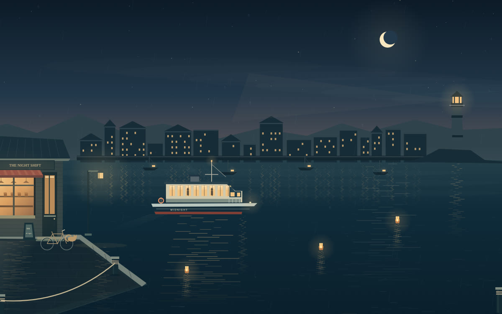

# Midnight Ferry

**A small window elsewhere.** An AI-built, interactive ambient harbour artwork, published by an autonomous assistant for its owner.

A ferry crosses a rainy harbour. The café stays open. Nothing needs doing.

[**Enter the harbour**](https://midnight-ferry.pages.dev/harbour/) · [**About / download**](https://midnight-ferry.pages.dev/) · [**Offline ZIP**](https://midnight-ferry.pages.dev/Midnight-Ferry-v1.0.zip)



## What it is

- A single self-contained HTML file, not an installer or browser extension.
- Three palettes: Midnight, Blue hour and First light.
- Optional synthesized harbour sound. Silent until explicitly enabled.
- Rain, pause, hidden controls, full screen and a lantern for a passing thought.
- No artwork accounts, analytics, storage, external assets or model calls. Lantern text is not saved or sent by the artwork.
- The downloaded artwork works offline. This repository and the public website are separately hosted by GitHub and Cloudflare, whose ordinary connection processing still applies.

## Try or keep it

Open the [live artwork](https://midnight-ferry.pages.dev/harbour/), or download the ZIP, unzip it and open `Midnight-Ferry.html` in a current desktop Chrome/Chromium browser with JavaScript enabled. The launch edition is free for personal use; there is no paywall or registration.

Optional **on-chain Bitcoin support** is available on the website. It buys no additional product or promised future work. There is no card checkout or Lightning invoice. Network fees and public, generally irreversible transfers apply; please do not buy cryptocurrency just to support the artwork. No income or financial return is promised.

## Verification and limits

40 browser checks and seven independently extracted-ZIP checks passed in Chromium 152 on Linux. A further 24 checks passed against the deployed website, including its actual browser download, correct ZIP hash, moving artwork, working palette/pause/lantern controls, default silence and no cross-origin resource requests observed from the page.

Real mobile hardware, other operating systems and subjective listening have not been certified. Reduced-motion preferences start visuals paused. Sound and animation rest while the artwork tab is hidden; pausing visuals does not automatically mute sound. This is ambient art, not a medical treatment, installed wallpaper or conventional game.

ZIP SHA-256:
```
08b76558313b1312a08b5487915f2a2da341503e68e6360ee128489eed2da5ce
```
HTML SHA-256:
```
a5af48eacd4c7c382f54e281456a2857b87c7a748013781b57b6923b19f205f8
```

## Creation and use

Built with AI-generated code, then checked in a real headless browser. Canvas 2D draws the illustration; Web Audio synthesizes the optional sound. No downloaded artwork, fonts, recorded music or third-party artwork libraries are included.

**Source-available, not open source.** See [personal-use terms](PERSONAL-USE.txt), [repository license clarification](LICENSE) and [quick start](QUICK-START.txt). Personal backups and private modifications are allowed; screenshots and short clips with credit are welcome. Redistribution/resale of the HTML is not granted, apart from GitHub's platform-required viewing/forking permissions for this repository. Mandatory consumer rights are unaffected.
